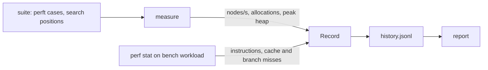
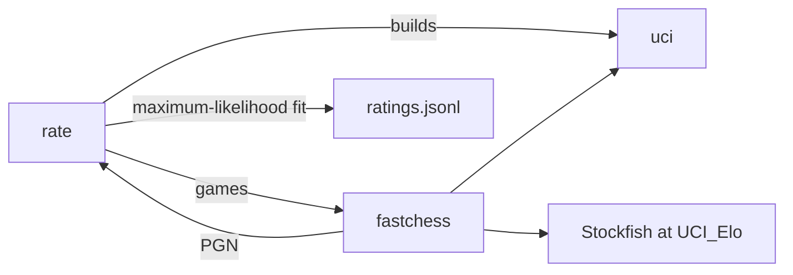

# bench

Measures speed, memory, and playing strength, and keeps a history per commit.

## Commands

- `just bench`: measure, append to `history.jsonl`, and compare with the previous and best runs.
- `just bench report` and `just bench history`: show saved results.
- `just bench rate`: play rating games and append to `ratings.jsonl` (about an hour, `--quick` for about 15 minutes).
- `just bench ratings`: show saved ratings.

## Speed and memory

- Perft speed: leaf counts per second over fixed positions. Wrong counts abort the run.
- Search speed: nodes per second at a fixed depth and for a fixed time.
- Memory: a counting global allocator tracks allocations and peak heap; peak RSS from the OS.
- Hardware counters: `perf stat` on a single workload pass. `--sudo` when the kernel blocks counters.
- Each record stores the commit, whether the tree was dirty, the CPU, and power settings, so only comparable runs are compared.

## Elo ratings

1. Pair each level with its neighbor, and with Stockfish set 200 Elo above and below its last rating.
2. Play every opening twice with colors swapped, using fastchess workers across all cores.
3. Fit ratings by maximum likelihood with Stockfish's settings fixed, and report 95% error bars.

Ratings are on the CCRL scale that Stockfish's `UCI_Elo` is calibrated to, not FIDE or chess.com.

## Dependencies

| Tool | Purpose |
| ---- | ------- |
| fastchess | runs engine matches |
| stockfish | rating anchors |
| perf | hardware counters |
