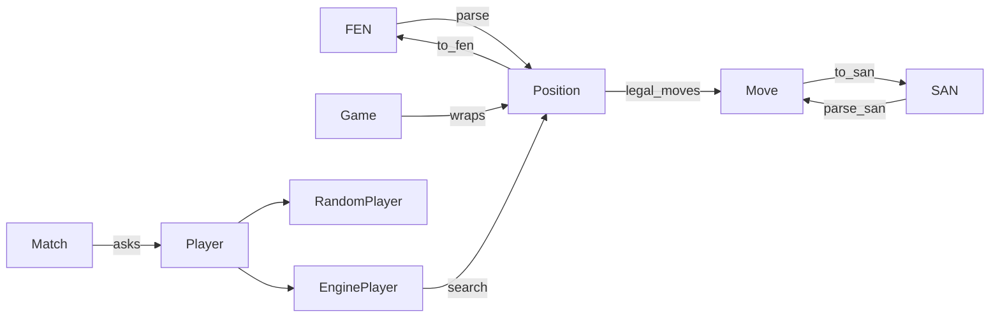

# game

The rules of chess and the engine. A library with no I/O, so every front end shares it and tests run headless.

## Overview

## Data representations

- `Position`: 36 bytes, `Copy`. Bytes 0..32 hold the board, 4 bits per square (color bit plus piece type). Bytes 32..36 pack castling rights, the en passant file, side to move, the halfmove clock, and the fullmove number.
- `Square(u8)`: 0..64, with a8 = 0 and h1 = 63.
- `Move(u16)`: promotion type in bits 0..4, source in bits 4..10, destination in bits 10..16.
- `Game`: a starting position plus the moves played. Detects threefold repetition.
- `Status`: ongoing, checkmate, stalemate, or a draw with its `DrawReason`.

## API interface

- `Position`: `from_str` (FEN), `to_fen`, `legal_moves`, `legal_moves_from`, `apply_move`, `parse_san`, `to_san`, `status`, `is_check`, `piece_at`.
- `Game`: `play`, `moves`, `position`, `status`.
- `Player` and `Match`: a `Match` polls each side's `Player` for a move with `tick`.
- `engine`: `Level`, `EngineSettings`, `EnginePlayer`, `think`, `search`.
- `perft`: counts leaf nodes, used to validate move generation.

Errors are `Error` values: invalid FEN, invalid move, or the game is over.

## Inner workings

### Move generation

1. Generate pseudo-legal moves from precomputed attack tables (`attacks.rs`). Knight, king, and pawn attacks are lookups; sliders mask full rays with the occupancy.
2. Apply each move to a copy of the position and drop it if the mover's king is attacked.
3. Castling also checks that the king does not pass through an attacked square.

### Engine

- Evaluation: material plus Michniewski's piece-square tables. The king table blends middlegame and endgame by the remaining material.
- Search: iterative-deepening negamax with alpha-beta pruning and a quiescence search over captures.
- Move ordering: the previous depth's best move, then captures ordered by most valuable victim and least valuable attacker, then promotions.
- Draws: the fifty-move rule, insufficient material, and repetition inside the search line.
- Levels: Beginner and Easy cap the depth (Beginner sometimes plays a near-best move instead). Medium and Hard search on a time budget.
- `EnginePlayer` searches on a background thread and publishes progress through `EngineInfo`.

## Testing strategy

- Perft from the start position, Kiwipete, and positions 3 and 4 against published counts.
- SAN round trips over every legal move in several positions and over famous games in `tests/pgn/`.
- Unit tests for FEN parsing, draw rules, and engine tactics.
