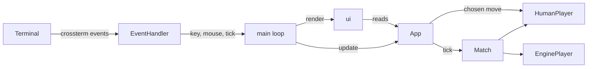

# tui

A ratatui front end: a human plays the engine with the keyboard or mouse.

## Overview

## Data representations

- `App`: all UI state. The `Match`, the cursor and selection, the open popup (`Mode`), the piece style, and hitboxes for mouse clicks.
- `HumanPlayer`: a `Player` that receives moves from the `App` over a channel.
- `PieceImages`: piece artwork encoded for terminals that support graphics, with a cache per square size.

## Inner workings

1. `EventHandler` reads terminal events on a thread and sends them with periodic ticks.
2. Key and mouse events update the `App`. A finished human move goes to `HumanPlayer`.
3. Each tick advances the `Match`, so the engine's move and search progress appear.
4. `ui::render` draws the board, the side panel, and any popup from the `App`.

Pieces draw as images when the terminal supports graphics, else as Unicode symbols or letters.

## Testing strategy

UI tests render to ratatui's `TestBackend` and assert on the buffer. App tests drive the `App` through its public methods.
