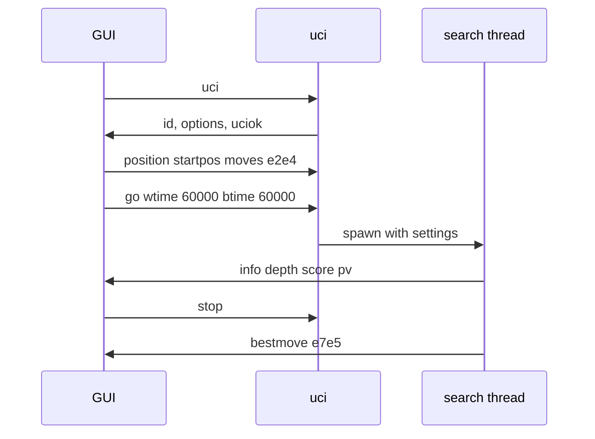

# uci

The engine as a UCI program, so GUIs and match runners such as fastchess can play it.

## Overview

## API interface

- Commands: `uci`, `isready`, `setoption`, `ucinewgame`, `position`, `go`, `stop`, `quit`.
- Options: `Level` (Beginner, Easy, Medium, Hard, or clock-managed Full) and `Move Overhead`.

## Inner workings

- `main.rs` reads stdin line by line and answers on stdout through `send`.
- `protocol.rs` parses and formats commands without I/O, so it is unit tested.
- `go` starts a search on a background thread, so `stop` and `isready` are answered while it thinks.
- Full strength budgets time from the clock: the remaining time over `movestogo` (30 if unknown) plus most of the increment, minus the move overhead.

## Testing strategy

- Unit tests for parsing and time budgets in `protocol.rs`.
- `tests/session.rs` drives the built binary the way a GUI would.
- `fastchess --compliance` passes.
