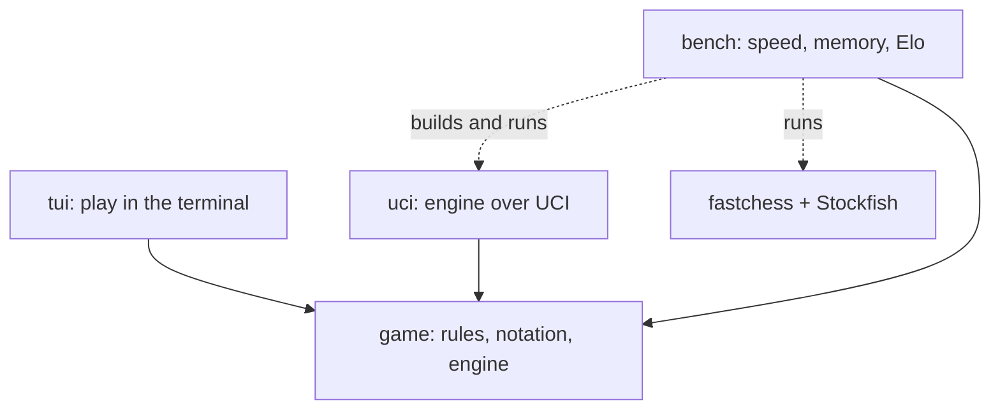

# chess

A chess library, engine, and terminal UI.

Add new pages to `SUMMARY.md` or they will not appear in the site.

## Crates

- [game](components/game.md): positions, legal moves, FEN, SAN, games, players, and the engine. No I/O.
- [tui](components/tui.md): a ratatui front end for human vs engine.
- [uci](components/uci.md): the engine as a UCI program for GUIs and match runners.
- [bench](components/bench.md): tracks speed and memory per commit, and rates the engine against Stockfish.
