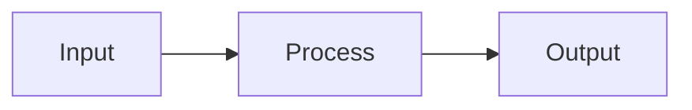

# Feature name

Delete sections that do not apply. Short sentences. No fluff.

## Overview

What it does and why.

## Diagram

Components, data flow, or state machine. Use Mermaid.

## Data representations

Types, structs, and how they relate.

## API interface

Public functions, messages, or commands. Inputs, outputs, errors.

## Inner workings

The algorithm, step by step.

## Runtime analysis

- Operations: time complexity, and what `n` is.
- Memory: space complexity, and what dominates it.

## Testing strategy

Unit, integration, and fixture tests. What each covers.

## Benchmarking strategy

What to measure, how, and the target numbers.

## Dependencies

| Crate | Purpose | Why not std or an existing dep |
| ----- | ------- | ------------------------------ |

## Errors and handling

| Error | Cause | Handling |
| ----- | ----- | -------- |

## Alternatives

Other approaches and why this one was chosen.
